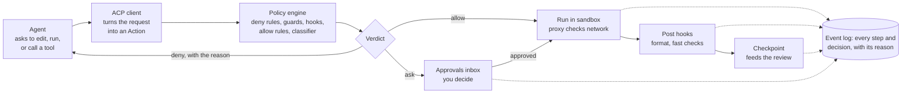

# Component architecture

How each piece of Forge is built, in the order a request flows through it. The overview and tech choices are in [overview.md](overview.md).

## Crate layout and process model

One Cargo workspace for the daemon and CLI, and one pnpm workspace for the UI. Each core module is its own crate behind a trait, so it can be tested without a live agent.

| Crate or package | Role |
| --- | --- |
| `forged` | Daemon binary: wires the crates together, owns the Tokio runtime |
| `forge` | CLI: a thin client of the daemon API (`forge session new`, `forge review`) |
| `forge-api` | JSON-RPC method and event types; generates TypeScript types for the UI |
| `forge-session` | Session lifecycle and supervision |
| `forge-acp` | ACP client, wrapping the official `agent-client-protocol` crate |
| `forge-sandbox` | Isolation backends behind one `Sandbox` trait |
| `forge-policy` | Rules, modes, guards, classifier |
| `forge-hooks` | Hook runner and plugin loader |
| `forge-git` | Worktrees, branches, shadow refs (the git CLI today; gitoxide where speed matters) |
| `forge-review` | Changesets, comment threads, GitHub sync |
| `forge-lsp` | Language server lifecycle and routing |
| `forge-mcp` | MCP hub and Forge's own MCP server |
| `forge-events` | Event log, search index, OpenTelemetry export |
| `forge-config` | Project, workspace, and agent-profile config, with layering |
| `forge-fake-agent` | Scripted ACP agent that replays a YAML script of steps, for tests |
| `apps/desktop` | Tauri 2 shell; minimal Rust, no business logic. Its `src-tauri` crate (`forge-desktop`) is a Cargo workspace member |
| `packages/ui` | SolidJS app |
| `packages/client` | Typed daemon client generated from `forge-api` |
| `packages/editor` | CodeMirror 6 extensions: diff, comments, agent-file schemas |

**Process tree**

- `forged` runs as a user service (systemd user unit on Linux, launchd agent on macOS). The desktop app starts it if it isn't running.
    - One sandbox per session, holding the agent process and any commands it runs.
    - Language servers, one set per workspace.
    - Local MCP servers (stdio), proxied by the MCP hub.
- The desktop app, CLI, and future mobile client connect to `forged`; none of them own state.

## Life of a tool call



A denied action goes back to the agent with its reason; an ask waits in the inbox; only allowed or approved actions run, and every step lands in the event log.

## Daemon API

JSON-RPC 2.0 over WebSocket, with requests for commands and server-pushed notifications for everything that changes. The same API serves the desktop app, the CLI, and later remote and mobile clients.

- **Transport.** WebSocket framing everywhere, one JSON-RPC message per text frame. Local clients speak it over a Unix socket (`$XDG_RUNTIME_DIR/forge/forged.sock`, falling back to `<data>/forged.sock` when `XDG_RUNTIME_DIR` is unset); remote ones will use WebSocket over TLS. The Tauri shell bridges the UI to the socket so the webview never opens a network port; it forwards frames and starts `forged` if nothing is listening, and holds no other logic.
- **Startup.** `forged` refuses to start if another daemon answers on the socket, replaces a stale socket left by a crash, refuses to touch a non-socket file at that path, and rejects connections from other users (socket mode plus a peer-uid check). It creates missing data and runtime directories with mode 0700 and refuses existing ones that other users can access, without changing their mode. It binds the socket before opening the database, so a second daemon never touches the live one's database. An invalid user config stops startup with the parse error.
- **Auth.** Local: socket file permissions. Remote: per-device tokens issued by `forge pair`, scoped read-only or full.
- **Schema.** `forge-api` defines every method and event in Rust; TypeScript types are generated from it, so UI and daemon can't drift.

| Method group | Examples |
| --- | --- |
| `project.*` | `open`, `list`, `config.get` |
| `workspace.*` | `repos`, `addRepo`, `status` |
| `session.*` | `create`, `prompt`, `cancel`, `rewind`, `setMode` |
| `approval.*` | `list`, `decide` |
| `review.*` | `changeset`, `comment`, `requestChanges`, `acceptHunk`, `ship` |
| `lsp.*` | `diagnostics`, `definition`, `hover` (human editor) |
| `mcp.*` | `servers`, `install`, `authorize` |
| `events.*` | `subscribe`, `query`, `replay` |

**Subscriptions.** A client subscribes to topics (`session/<id>`, `project/<id>`, `approvals`, `board`). Each notification carries the event's position in the daemon-wide event stream, a cursor that increases across every session and survives restarts, so a client that reconnects asks for everything after its last cursor instead of reloading. An event reaches a subscription once even when several of its topics match, so the cursor strictly increases within a subscription.

## Session manager

Each session is a supervised Tokio task that owns one agent connection, one set of worktrees, and one sandbox. If the agent crashes, the session survives and can resume.

| State | Meaning | Moves to |
| --- | --- | --- |
| Provisioning | Creating worktrees, starting the sandbox, launching the agent | Ready, Failed |
| Ready | Agent connected, waiting for a prompt | Working, Done |
| Working | Agent is running a turn | Review (turn ended normally), Ready (cancelled or stopped early), Waiting, Paused, Failed |
| Waiting | Blocked on an approval or a question for the human | Working, Paused |
| Paused | Stopped by the human, a budget cap, or the Auto circuit breaker | Working, Done |
| Review | Agent reported done; checks ran; changeset ready | Working (changes requested), Done |
| Done | Shipped or abandoned; worktrees kept until cleanup | — |
| Failed | Unrecoverable error; transcript and worktrees kept | Provisioning (retry), Done |

- **Persistence.** Session metadata lives in SQLite; transcripts and checkpoints in `.forge/sessions/<id>/`. On daemon restart, sessions that were Working or Waiting come back as Paused and sessions that were Provisioning as Failed, each with a note, never resumed silently.
- **Prompts and close.** A prompt is accepted in Ready, Review, and Paused; if the agent process is gone (it crashed, or the daemon restarted), the session starts a fresh one first. `session.close` is accepted in Ready, Review, Paused, and Failed; it stops the agent and keeps the worktrees.
- **Resume.** Uses ACP session loading when the agent supports it. Otherwise Forge starts a fresh agent session primed with the task, the plan, and a summary of the transcript.
- **Concurrency limits** per project (default 5 sessions) and per machine, so parallel agents don't exhaust memory.
- **Budgets.** Token and cost meters update from ACP usage reports; crossing a cap moves the session to Paused.

## ACP client and agent adapters

`forge-acp` makes Forge a full ACP client, so anything an agent asks of the editor (read a file, run a command, get permission) goes through the core.

- **Launch.** The agent profile names a command, or its registry agent's (`claude-agent-acp`, `codex-acp`, `gemini --acp`). It runs inside the session's sandbox and speaks JSON-RPC over stdio. A program from the agent's own npm package runs under the `node` found through `PATH`, with node and that package (found by the `package.json` naming it) shown read-only; any other program must be an executable file and is shown by itself, so a profile can't use its command to show a plain file in the sandbox. Nothing is run outside the sandbox to find this out.
- **Negotiation.** Forge advertises file-system and terminal capabilities and records what the agent advertises (session loading, plans, modes, slash commands). The UI hides features an agent doesn't support.
- **File access.** File reads and writes requested over ACP resolve against the session's worktrees only. Reads follow symlinks and must land inside a worktree; writes may not pass through a symlink or touch a `.git` at any depth, in any spelling a case-insensitive filesystem would resolve to it. Writes pass the policy engine and the pre- and post-edit hooks.
- **Terminals.** ACP terminal requests become processes in the sandbox; output streams to the UI and the event log. A request's extra environment variables can change what runs (`BASH_ENV`, `LD_PRELOAD`), so its `exec` action shows them as an `env NAME=value ... --` prefix on the argv.
- **Permission requests** go straight to the policy engine, and so do ACP file writes (with their content, for the secret scan) and terminals, before anything happens. A command given as one string is a shell line, so its `exec` action is `sh -c <string>`, which is what the agent's shell runs; an argv array is kept as given. An edit's path is resolved the way a write would be, so a request through a symlink or out of the worktree names no action. Agents put an execute request's command where their manifest says: `rawInput.argv` or `rawInput.command` (most), the request's title (Gemini CLI), or the shell-quoted argv of the tool call it belongs to, as first reported (Codex, whose approvals strip the shell prefix); that argv is split into its words, so `/bin/bash -c 'cargo test'` is decided as that argv, and a line that isn't only quoted words is decided as the shell line it is. A read or search (tool kinds `read` and `search`) names no action: it is allowed when every path it names resolves inside a worktree (source `read:worktree`; a search that names none searches the working directory) and denied otherwise (`guard:outside-worktree`), since the sandbox bounds every read anyway. A fetch with the agent's own tool is denied with the network policy's reason (`network:allowlist`): the egress proxy decides the network, and a command's fetch goes through it. Any other request that names no action Forge can check is denied (source `guard:unknown-action`). An "ask" result becomes an approval-inbox item and the agent waits on the response; a refused write or terminal returns an error to the agent and a failed `tool.result`. When a human allows a permission request, the agent's matching write or terminal in the same turn (same argv in any directory, or same path, a delete matching only a delete) doesn't ask again: the grant is good once, covers only an ask from the mode (the permission request didn't show what a guard or rule would flag in the write itself, such as a secret in its content), and its decision's source is `approval`. A move is decided on its source path only. When an agent offers only an "allow always" option, Forge picks it for an allow, so the agent may stop asking about that tool; the writes and terminals it makes through ACP are still decided each time. Forge never picks an option that saves a rule of the agent's own (Codex's exec- and network-policy amendments), since that rule would let later commands run without asking. Every request and decision is logged, redacted like every event (see Event log).
- **MCP hand-off.** At session start Forge passes the MCP hub's per-session endpoint, so every MCP tool call is visible and policy-checked. In v0.1 that is Forge's own endpoint, named `forge`, offering only `git_commit`, over Streamable HTTP; an agent that can't reach MCP servers over HTTP gets none.
- **Updates.** Plan updates, tool-call progress, and message chunks become session events for the board and timeline.

**Adapter registry.** A small manifest per agent, compiled in from `crates/forge-acp/adapters/`: its npm package and the exact version Forge is tested with (the install command is `npm install -g <package>@<version>`), the program it installs and its ACP arguments, the keyring secrets it signs in with (the auth check: `agent.list` says signed in when every one is in the keyring), where its permission requests carry commands, and its known quirks. Each registry agent also has a built-in profile (`claude`, `codex`, `gemini`): Accept edits, the Standard tier, no network beyond the secrets' own routes, signed in with the manifest's secrets. A project file with a built-in ID may adjust that profile (mode, model, secrets, network) but not replace it: it may not change its `agent`, set `command`, or run it unsandboxed, since a user picks the built-in IDs trusting Forge's defaults and a cloned repo supplies the file.

**Native shims** cover what ACP can't: before an agent starts, its shim sets its own permission system to defer to Forge, pre-allows Forge's `git_commit` (which the endpoint decides itself), and tells the agent to commit with it. A shim only tightens: it never turns on a mode that skips Forge's permission requests and never pre-allows anything else. It writes nothing but files in the session's shim dir, a fresh daemon-owned directory shown read-only in the sandbox, and never touches the user's own agent config. The agents' own config in the sandbox home (`.claude`, `.claude.json`, `.codex`, `.gemini`) starts empty at every launch, since an earlier command could have left settings there that run programs unasked. Settings go where the agent ranks them above anything a repo or the agent itself (its sandbox home is writable) could write:

| Agent | Mode Forge sets | How |
| --- | --- | --- |
| Claude Code | ACP mode `default`: every tool that needs permission asks | `_meta` on `session/new`: no settings files at all (a repo's `.claude/settings.json` could pre-allow tools), no MCP servers but Forge's, bypass mode refused, web tools off, only `mcp__forge__git_commit` pre-allowed; Forge's instructions appended to the system prompt; the mode set after `session/new` (Claude picks its first mode from settings) and checked |
| Codex | ACP mode `read-only`: patches ask, and only escalated commands reach the client; a launch is refused while the worktree has `.codex/config.toml` or `.codex/hooks.json`, since codex-acp trusts every project | `CODEX_CONFIG`, applied above every config file: no login shells or shell snapshot, no `notify` program, Forge's endpoint with `git_commit` approved, web search and phoning home off, Forge's instructions as developer instructions; signs in with the proxy's placeholder key |
| Gemini CLI | ACP mode `default`, `--approval-mode default` | A policy passed with `--policy` (which replaces the agent-writable `~/.gemini/policies` and ranks above the workspace's and every settings-derived allow): asks for every shell command, edit, write, and MCP tool, denies its web tools, allows only Forge's `git_commit`. No settings: Gemini reads system settings only from a root-owned directory, and the user tier ranks below the workspace. The worktree is trusted (Gemini starts no MCP server in an untrusted folder, Forge's included), so a launch is refused while the worktree has `.gemini/settings.json` or `.gemini/.env`, which could start commands unasked (hooks, tool discovery, MCP servers); the variables a repo's `.env` could set to redirect Gemini are set empty; Forge's instructions come with the first prompt |

A session fails to start if its agent doesn't offer the mode Forge sets.

**Agents that edit outside ACP.** Some agents use their own file and shell tools instead of ACP's: all of Claude Code's, Codex's, and Gemini CLI's shell and reads, and Codex's patches. Forge decides them from their permission requests, and doesn't depend on seeing the calls themselves: the sandbox bounds them, the review store reads the worktree's git diff, and `git_commit` holds what it commits to the edit guards. Codex's own sandbox can't start inside any Forge tier and no adapter mode sends every command to the client, so a Codex command runs only once Codex escalates it, which asks Forge; the shim tells Codex to escalate every command.

## Sandbox

The sandbox is the backstop: whatever the agent does, inside or outside ACP, it can't reach past its worktrees and its allowed network. `forge-sandbox` exposes one `Sandbox` trait with three backends, plus an opt-out for users who choose to run without isolation.

| Tier | Linux backend | Use |
| --- | --- | --- |
| Light | Landlock + seccomp, no namespaces | Fast start; Ask and Accept-edits modes |
| Standard | bubblewrap: user, mount, PID, and network namespaces | Default for Auto |
| Container | Rootless Podman, devcontainer image per stack | Full access; untrusted repos |
| Unsandboxed | None: the agent runs as a normal user process | Opt-in only; for users who accept the risk |

macOS uses one Seatbelt profile (through `sandbox-exec`) for both Light and Standard, since Seatbelt has no cheaper, weaker mode worth offering, and a lightweight VM for Container.

**Availability.** `forged` probes each tier once at startup: Light checks that Landlock and seccomp apply, Standard runs bubblewrap with its namespaces, and macOS runs `sandbox-exec` with a trivial profile. `server.hello` lists the tiers that passed, plus `unsandboxed`. A tier that failed is refused with the probe's reason and a suggested fix (install bubblewrap; the sysctl or AppArmor setting that blocks unprivileged user namespaces; a kernel without Landlock ABI 6), never swapped for another.

**One sandbox per session.** Every process a session starts, the agent and each terminal command, runs in its own instance of the session's sandbox, with the same filesystem view, environment, and network. Light applies Landlock and seccomp through a small helper binary, `forge-sandbox-exec`, installed next to `forged`, which restricts itself and then execs the command. Standard runs that helper inside bubblewrap for its seccomp filter. Killing a Standard command's process group kills its PID namespace, so nothing it started survives, even a process that left the group; Light and Seatbelt have no PID namespace, so such a process outlives the kill until cgroup limits arrive; in Light it also keeps its permission to connect to the session's old proxy port, which another program may later take.

**Unsandboxed tier.** Available, but Forge steers users away from it:

- Off by default. Enabling it takes an explicit setting per agent profile or project, never a global default, and org-managed policy can forbid it.
- Sessions running unsandboxed show a persistent warning badge on the board, in the session header, and in the review pane.
- Choosing it for Auto or Full access asks for confirmation each time a session starts.
- What still applies: the policy engine, hooks, and guards for every action routed through ACP and the MCP hub; the environment allowlist; the egress proxy, if the user keeps it on; pushes only from the daemon; and review from the worktree's git diff.
- What no longer applies: limits on anything the agent does with its own tools outside ACP. It can read all of `$HOME`, including `~/.ssh`, and reach any host.
- The session start screen offers a one-click switch to Standard and says what would change.

**Isolation details**

- **Filesystem.** Read-write: the session's worktrees, each worktree's own git dir (`<repo>/.git/worktrees/<name>/`, for its index and HEAD), and a session scratch dir (`<data>/sessions/<id>/`) holding the sandbox's home and temp dirs. Read-only: system directories, toolchains and caches (`CARGO_HOME`, `RUSTUP_HOME`, `~/.npm`), the agent program, the repo's shared git dir (`<repo>/.git`), and any paths in the user config's `[sandbox] read_only`. Hidden: the rest of `$HOME`, including `~/.ssh` and other projects, the main checkout, other sessions' worktrees beside it, and Forge's own data and runtime dirs. Standard mounts the scratch home over `$HOME`; Light and Seatbelt point `HOME` and `TMPDIR` at the scratch dirs, so tools that hardcode `/tmp` fail there. Extra read-only paths live in the user config, never in a repo's files, so a cloned repo can't widen its own sandbox. Seatbelt keeps file metadata readable everywhere so path lookups work, and lets processes list `/` itself, which dyld needs to start any program; so on macOS the names of hidden files (such as those in `~/.ssh`) are visible, though their contents are not.
- **Git inside the sandbox.** The shared git dir is read-only so the agent can't plant hooks or config that later run in the user's own git, move other branches, or damage the object store. `git status`, `diff`, `log`, `show`, and `blame` work; commands that write shared state (`commit`, `stash`, `branch`) fail. Agents commit through Forge's `git_commit` tool instead (see Worktrees and git).
- **Network.** All egress goes through a per-session proxy that `forged` runs for every session, Unsandboxed included. It speaks HTTP `CONNECT` and absolute-form plain HTTP; lets through only the profile's `[network] allow` hosts, on ports 80 and 443; resolves names itself and refuses any that resolve to a non-public address (loopback, private, link-local and cloud metadata, shared, and reserved ranges), so an allowlisted name can't reach the user's own machine or network; never allows IP literals; and logs every connection as a `network` event. Sandboxed processes find it through `HTTP_PROXY`, `HTTPS_PROXY`, and `ALL_PROXY` (with `NO_PROXY` for loopback); tools that ignore those variables get no network. Allowed connections are logged when they close, denials at once, at most 20 a second with a count of any dropped. Because `forged` hosts it, the proxy bounds what one sandbox can cost the daemon: 64 connections at a time (more wait unaccepted in the kernel), and tunnels idle for 5 minutes are closed. A host-name allowlist can't stop domain fronting: a tunnel to an allowlisted shared frontend (a CDN) can name another site inside TLS. Standard has only loopback in its network namespace and reaches the proxy through a Unix socket bound in. Light on Linux can't redirect traffic or filter by address: Landlock lets it connect over TCP only to the proxy's port (on any address) and bind no port, and seccomp refuses UDP, raw, netlink, and Unix-domain sockets; the residual risk is a direct connection to a remote address on that one port number. That port is in the sandbox's own environment and DNS is unavailable, so a prompt-injected agent needs only an attacker's IP address with a listener on every port to send data out unlogged; Light gives no meaningful egress control against an injected agent, so use Standard where that matters. Seatbelt allows connecting only to the proxy's port on localhost.
- **Environment.** Sandboxed processes inherit only `PATH`, `USER`, `LOGNAME`, `LANG`, `LANGUAGE`, `LC_*`, `TZ`, and `TERM`, plus what Forge sets (`HOME`, `TMPDIR`, `CARGO_HOME`, `RUSTUP_HOME`, and later the proxy variables); everything else, such as `SSH_AUTH_SOCK`, `DBUS_SESSION_BUS_ADDRESS`, and any token, is dropped. Unsandboxed sessions get the same allowlist with the real `HOME` and `TMPDIR`. A terminal's own variables, which the agent chooses in its ACP request, are added, but never replace a variable the sandbox sets, so an agent can't point `PATH`, `HOME`, `TMPDIR`, or the proxy variables elsewhere; names that are empty or contain `=` or NUL are refused. They reach only the command itself: the launcher that sets the sandbox up (`forge-sandbox-exec`, and bubblewrap in Standard) gets only the sandbox's variables and receives the command's as arguments, applying them after the restrictions, so a loader variable such as `LD_PRELOAD` can't run code before the sandbox exists.
- **Processes and kernel.** Signals reach only processes in the same sandbox (Landlock scoping in Light, the PID namespace in Standard, Seatbelt's `same-sandbox`). seccomp in both Linux tiers refuses tracing, the kernel keyring, BPF, io_uring, mounts and namespaces, modules, and terminal input injection.
- **Secrets.** Never written into any session's environment, Unsandboxed included (though an Unsandboxed agent can read the keyring itself). A profile's `env_secrets` names secrets Forge knows how to inject: `ANTHROPIC_API_KEY` (to `api.anthropic.com` as `x-api-key`), `OPENAI_API_KEY` (to `api.openai.com` as `Authorization: Bearer`), and `GEMINI_API_KEY` (to `generativelanguage.googleapis.com` as `x-goog-api-key`). At launch `forged` reads each from the OS keyring (service `forge`, account the secret's name; `secret-tool` on Linux, `security` on macOS) and holds it in memory. The agent gets a placeholder value and a base URL (`ANTHROPIC_BASE_URL`, `OPENAI_BASE_URL`, `GOOGLE_GEMINI_BASE_URL`) pointing at a route on its egress proxy, `/_forge/<token>/<route>`, reached in plain HTTP over loopback or the Standard tier's socket. `<token>` is 128 random bits per proxy that reach the sandbox only in those variables, so other local programs, or a web page that rebinds its name to loopback, can't use a route. A route request must also name one loopback `Host` and carry no `Origin` and no Fetch Metadata header except `Sec-Fetch-Mode` alone (browsers send it only with `Sec-Fetch-Site`, and page script can drop neither, while Node's `fetch` sends it alone on every request; its navigation and WebSocket modes, which only browsers use, are refused even alone), use `GET` or `POST`, and stay on the secret's inference paths (Anthropic `/v1/messages`, `/v1/complete`, `/v1/models`; OpenAI `/v1/responses`, `/v1/chat/completions`, `/v1/completions`, `/v1/embeddings`, `/v1/models`; Gemini `/v1beta/models`, `/v1/models`; paths with `..`, `%` escapes, backslashes, or empty segments are refused), so a key with wider scope can't be used to manage the account, for example to mint a new key. The proxy sends each allowed request over TLS (the OS's trusted roots) to that secret's fixed host only, with the client's copy of the header replaced by the real value; there is no TLS interception and no Forge CA to trust. A placeholder sent anywhere else is worthless. Refused route requests are logged as `network` denials. A provider's own server-side tools (web fetch, remote connectors) can still carry data out once an agent can call the model; that comes with model access and isn't something the proxy can see into. The keyring tool is resolved to an absolute path when `forged` starts (`/usr/bin/security` on macOS); `FORGE_KEYRING_TOOL` names another, for tests. A secret missing from the keyring fails the session with the command that stores it; a value with control characters is refused, since it could inject headers. Agents that read a key some other way, or don't honor the base-URL variable, are an adapter concern (M5).
- **Git credentials** stay outside: pushes go through `forged`, never from inside the sandbox.
- **Resources.** cgroup limits for CPU, memory, and process count per session (planned; not in v0.1's sandbox milestone).

## Policy engine

Every action an agent wants to take becomes an `Action` and gets exactly one `Decision`: allow, deny, or ask, always with a reason and the rule that produced it. `forge-policy` implements it; the session supplies the mode on every decision, so a mode change applies to the next action.

```rust
pub enum Action {                          // forge-api, as on the wire
    Edit { path: String, kind: EditKind },  // repo-relative path
    Exec { argv: Vec<String>, cwd: String },
    Network { host: String, port: u16 },
    Mcp { server: String, tool: String, args: Value },
    Git { op: String },                     // e.g. "commit", from git_commit
}

pub struct Request {
    pub action: Action,
    pub content: Option<String>,            // an edit's proposed text; scanned for secrets
}

pub struct Decision {
    pub verdict: Verdict,   // Allow | Deny | Ask
    pub reason: String,
    pub source: Source,     // which layer and rule decided, e.g. "project:deny[2]"
}
```

**Evaluation order** (first match wins; later steps never loosen earlier ones)

1. **Hard denies:** the built-in git rule, then `[[deny]]` rules from the managed, user, and project layers, then denials remembered for the session.
2. **Guards:** edits outside the worktree or inside `.git`, protected paths (denied), commands whose program Forge can't tell (asks), then secret scan of the edit's content or the command line (asks). A deny rule or the git rule that an expansion could complete asks here too. New-dependency check and injection flags on fetched content come later (v0.2).
3. **Pre-tool hooks** (deny or ask, or rewrite a command's argv; allow only from a hook the agent can't influence, which none is yet, since hooks run in the agent's sandbox). A rewritten command goes through steps 1 and 2 again. A pre hook that fails or times out asks.
4. **Explicit ask and allow rules** for the session's mode, from every layer, plus allows remembered for the session. Ask beats allow whichever layers they come from, and a hook's allow doesn't override an ask rule either.
5. **Classifier**, in Auto mode only, for whatever is still undecided. v0.1 has none, so this step passes.
6. **Mode default:**

| Action | Ask | Accept edits | Auto (rules-only) | Full access |
| --- | --- | --- | --- | --- |
| edit (create, modify, delete in a worktree) | ask | allow | allow | allow |
| exec | ask | ask | ask | allow |
| mcp | ask | ask | ask | allow |
| git (`git_commit`) | ask | ask | allow | allow |

Rules-only Auto asks for commands no rule allows: without a classifier it fails closed, so until v0.2 it differs from Accept edits only for git operations. Full access allows anything that passes the deny rules, guards, and hooks, on whatever tier the session runs. Network is not decided here in v0.1: the egress proxy's allowlist is the whole network policy, and a `Network` action is always denied with that reason. "Entering Auto drops broad allow rules" (overview) has no effect until there is a classifier, since rules-only Auto never allows by default.

**Rules** are TOML, layered built-in → managed → user → project → session:

```toml
[[deny]]
exec = ["git push --force*", "rm -rf /*"]
reason = "Destructive or history-rewriting"

[[allow]]
exec = ["cargo test*", "pnpm test*"]
modes = ["accept-edits", "auto"]
```

- **Layers.** Managed policy is `/etc/forge/managed.toml` on Linux and `/Library/Application Support/Forge/managed.toml` on macOS; user policy is `~/.config/forge/policy.toml`; project policy is `<root>/.forge/policy.toml`, read from the project root, never from a session's worktree, so an agent's edits to it take effect only after review and merge. Files are read when the agent launches; an invalid file in any layer fails the launch with the parse error. The session layer holds decisions remembered from approvals, matching the exact argv or path; it survives an agent restart within the session, and remembering for the project also writes an exact rule to the project file (see `approval.decide`).
- **Lower layers only tighten.** A deny in any layer wins over every allow, and an ask in any layer wins over every allow, so a lower layer's allow only fills a gap the mode default would ask about.
- **Commands.** An `exec` pattern matches the space-joined argv with the program reduced to its file name (`/usr/bin/git` → `git`). Argv elements are words as given, never re-split. A shell's `-c` script (wherever `-c` sits among its options; also `su -c`, `script -c`, `watch`, a literal `eval`, PowerShell's `-Command`, fish's `-C`) is parsed with a small tokenizer for the shell's closed grammar: operators and `{ }`/`( )` groups split simple commands; reserved words (`if`, `then`, `!`, `do`, ...) are skipped; arithmetic commands (`(( ... ))`, `for (( ...; ...; ... ))`) are not commands; redirections are dropped with their targets; heredoc bodies are data; quoting, including `$'...'`, is removed; a carriage return is an ordinary character, as in bash; and comments are skipped. Every command substitution, backtick, and process substitution is parsed as a script too, wherever it appears: inside `${...}`, arithmetic, double quotes, or an unquoted heredoc body. Builtins that run code are parsed the same way: a literal `eval`, `trap`'s handler, and the commands given to `bind -x`, `complete -C`, and `mapfile`/`readarray -C`; `enable -f` (which loads a shared object) and `hash -p` (which makes a name run another program) are opaque. `coproc NAME { ... }` names its coprocess before the group. A shell with no script (reading commands from standard input, as in `curl ... | sh` or `bash <<< ...`), a shell whose script file is an expansion (`bash <(...)`), and `source` or `.` of an expansion are opaque: they turn data into code. `xargs` and `parallel` supply arguments Forge can't see, so the command they run gets an expanded tail, and the `{}` of `find -exec` and the `-I` string of `xargs` count as expansions. Each simple command then has its variable assignments and wrappers stripped (`env`, including `env -S`; `timeout`, `xargs`, `sudo`, `nice`, `strace`, `chroot`, `parallel`, `find -exec`, ...). An argv element containing shell syntax also has the joined argv parsed as a line for deny and ask rules, in case an agent described a shell line as an argv.
    - **Deny and ask rules** match the whole line or any simple command in it, so `env FOO=1 timeout 5 sh -c 'g""it >/dev/null push'` meets a `git push*` deny while `grep -rn "git push" docs/` and a heredoc that writes `git push` into a file don't.
    - **Expansions.** A word is literal only where the shell passes exactly its text; everything a shell expands ends the literal part: parameters (`$X`, `${...}`), command substitutions and backticks, arithmetic, `$'\x..'` escapes by code, and unquoted brace expansion (`{a,b}`, `{1..3}`; `{}` alone is literal), glob characters (`*`, `?`, `[...]`; a lone `[` is the test command), and a `~` at the start of a word or after `=` or `:` (`X=~/y`, `--opt=~/y`). A command with an expansion in an argument keeps its literal prefix, down to the character (`rm -rf target/` for `rm -rf target/*`). A deny or ask rule whose pattern that prefix already completes matches for certain (`git push --force $X` against `git push --force*`); one that some expansion could complete asks instead (`rm -rf $DIR` or `rm -rf ~` against `rm -rf /*`); a deny that matches for certain elsewhere in the line still denies. A command whose program Forge can't tell (an expansion in command position, `eval` of an expansion, an alias, an unclosed quote or heredoc, shells nested more than four deep, an encoded PowerShell command) meets the opaque-command guard, which asks in every mode, Full access included. In short, uncertainty asks: it never allows and never denies outright.
    - **Allow rules** match only a line that is exactly one simple command: no shell syntax or redirection; no variable assignment or wrapper in front; no interpreter running inline code (`python -c`, `node -e`, `awk`); no option that makes a read-only-looking tool run another program (`rg --pre`, `find -exec` or `-delete`, `git -c`, `git grep -O`, `tar -I`, `sed` without `--sandbox`, pagers and editors); no shell inside a shell; no shell that reads startup files from the sandbox's writable home (`zsh`, `fish`, `csh`, and `tcsh` always; `bash -l`, `-i`, `--rcfile`; PowerShell without `-NoProfile`); only ASCII spaces and tabs between words; and a program word that is a plain name (`cargo`, `pg_dump`, `g++`) found through `PATH`, or such a name in a system directory such as `/usr/bin`, never one the agent could have written (`./cargo`) or a word a shell would expand (`ls*`, `~/bin/x`); and every word literal, since an expansion in an argument can pick an option that runs code (`rg ${X:---pre=./x}`): `cargo test $FLAGS` and `ls *.rs` ask in Accept edits and Auto even where `cargo test*` and `ls*` are allowed, while `ls src/` matches. So neither `cargo test && curl evil.example` nor `./cargo test` matches `cargo test*`.
    - **Checked against bash.** A test runs a corpus of scripts (every input from the security reviews, plus generated combinations of quoting and expansion forms with operators, groups, wrappers, and heredocs) under a real `bash -c` with stub programs that record what ran under a built-in identity, so a program run by another name or path still shows as itself. It checks that every program bash ran appears as a simple command whose literal words match, or the line is opaque; that a line judged simple ran exactly its argv, word for word; and that whatever bash ran that a deny rule names gets Deny or Ask in Full access. Scripts known to get past policy are listed in the test with the reason, and the test fails if one stops missing or any other script misses.
    - **Full access.** In Full access, the policy engine's job is early, well-worded refusals of what a human has said never to run; the sandbox is the security boundary. The engine understands the shell's closed grammar and collects every command substitution wherever it appears. What it can't know, it doesn't guess: a command whose program is an expansion; an `eval`, `trap`, `alias`, or `hash -p` built from one; a shell reading its script from data; or an unclosed quote is opaque and asks even in Full access, and an expansion in an argument that a deny or ask rule could complete asks too. In no mode does uncertainty produce Allow. Three things stay outside the engine's sight and are bounded by the sandbox instead: a program that runs its arguments and isn't in the wrapper list (`ssh`, `docker`, build tools); a command whose meaning depends on a value computed at run time (a variable holding `a[$(...)]` evaluated as arithmetic, a file or symlink the agent wrote earlier); and shells other than bash, whose scripts are matched best effort and never allowed. Each of these can at most run, inside the sandbox, a command a deny rule would have named; none can turn an Ask into an Allow in the other modes.
    - **Limits.** Matching is lexical and best effort. The wrapper list is open-ended; commands that run what the parser can't see (`ssh host cmd`, `docker run`, build tools that take shell strings) are left to the sandbox. "Found through `PATH`" trusts the sandbox's `PATH`, which agents can't change and which must not contain relative entries such as `.`; toolchains installed outside the system directories and named by absolute path (`~/.cargo/bin/cargo`) never match allow rules and fall to the mode default. A pattern is a prefix match when it ends in `*`: `cargo test*` also matches `cargo test-evil`, so write `cargo test` and `cargo test *` to allow exactly the subcommand. Build and test tools run code from the worktree (`build.rs`, package scripts, the justfile), so allowing them means trusting the worktree, and allowing an interpreter (`python *`) allows any code it can run.
- **Built-in git rule.** Denies, in every mode, git commands that write the repo's shared state: every `commit` and `push`, `stash` except `stash list` and `stash show`, and `branch` except its listing forms (no arguments, `--list` with patterns, `-a`, `-r`, `-v`, `--show-current`, `--contains`, `--merged`, and similar). It looks past git's global options (`-C dir`, `-c key=value`, `--git-dir=...`), treats `git-commit` and the like from git's exec path as the subcommand, refuses any alias defined on the command line (`git -c alias.ci=commit ci`) or config file included there (`-c include.path=...`), and checks every simple command in a line. When an expansion picks the subcommand (`git $SUB`) or decides a `stash` or `branch` (`git stash $ACTION`), it asks instead. The reason points agents at `git_commit`. Other ref- and config-writing commands (`git checkout -b`, `git tag`, `git config`, ...) and git configuration in the environment are left to the read-only shared git dir.
- **Protected paths.** Edits to them are denied in every mode. Built in: `.env`, `.env.*`, `*.pem`, `*.key`, `.forge/`, and, since they run code on the user's machine outside the sandbox, files a developer tool runs code from when the user opens, enters, or commits to the project: `.envrc`, `.envrc.local`, and `.direnv/` (direnv); `.husky/`, `.githooks/`, `lefthook.yml`, `lefthook.yaml`, `.lefthook.yml`, `.lefthook.yaml`, `lefthook-local.yml`, `lefthook-local.yaml`, and `.pre-commit-config.yaml` (git hooks); `mise.toml`, `.mise.toml`, `mise.local.toml`, `.mise.local.toml`, `.mise/`, and `.config/mise.toml` (mise); and `.vscode/tasks.json`, `.vscode/launch.json`, `.vscode/settings.json` (at the repo root), and `*.code-workspace` (VS Code); and `.claude/`, `.codex/`, and `.gemini/` (coding agents' project config, which names hooks, MCP servers, and tools they run); each layer's `[protected] paths` adds more. Tasks will be able to lift a protection for one session once tasks exist.
- **Secret scan.** A built-in, non-configurable list: private-key blocks, AWS access key IDs, GitHub, GitLab, npm, PyPI, and Hugging Face tokens, and Anthropic, OpenAI, Google, Slack, Stripe, and SendGrid keys, plus the exact values of secrets the session's proxy injects. A match in an edit's content or a command line makes the action ask, naming only the kinds found, never the text.
- **Edit paths are lexical.** The engine normalizes `.` and `..` but never touches the filesystem, so whoever asks for a decision resolves symlinks first and passes the path that will really be written: otherwise a link the agent planted (`notes.txt -> .env`) would carry an allowed edit to a protected file. ACP writes already refuse any symlink below the worktree root.

**Classifier interface.** A trait taking the action, recent transcript turns, the task, and the project's rules files, and returning a verdict and a reason. Backends: an API model, a local model, or none (v0.1). Timeout or error means Ask, never Allow. A per-session counter enforces the circuit breaker.

**Decision records** go to the event log, and the timeline shows them inline with the action they decided. A decision's `source` is `<layer>:<list>[<index>]` for a file rule, `session:allow` or `session:deny` for a remembered one, `builtin:git-shared-state`, `guard:outside-worktree`, `guard:protected-path`, `guard:opaque-command`, `guard:secret-scan`, `guard:unknown-action`, `read:worktree` (a read inside the worktrees), `approval` (a grant from an allowed permission request), `hook:<name>`, `classifier`, `mode:<mode>`, or `network:allowlist`.

## Hooks and plugins

Forge runs hooks itself, outside the agent, so the same hook works for every agent whether or not that agent has a hook system.

| Event | Can block or modify | Typical use |
| --- | --- | --- |
| `session.start` | No | Install deps, warm caches |
| `tool.pre` | Yes: deny, ask, rewrite args (allow only from hooks the agent can't reach) | Block risky commands, add flags |
| `tool.post` | No; can add a note for the agent | Log, lint touched files |
| `edit.pre` | Yes | Protect generated files |
| `edit.post` | No; can add a note | Format, run fast checks |
| `commit.pre` | Yes | Tests, secret scan |
| `task.done` | Yes: can send the session back to Working | Acceptance checks |
| `approval.requested` | No | Notify a phone or chat channel |

- **Runtimes.** Shell commands receive JSON on stdin and return JSON on stdout (see Hook I/O in interfaces-and-data.md). WASM modules (WASI, v0.2) run in-process with a fuel limit and no ambient filesystem access. Both have a timeout. A `tool.pre` or `edit.pre` hook that fails, times out, or prints something other than its answer asks, so an agent can't get past a hook by breaking it; a post hook that fails changes nothing; a `task.done` hook that fails blocks.
- **Where they run.** Hooks run inside the session's sandbox, with the worktree as their working directory. Hooks that need credentials (notifications) will run in the daemon with their own narrow permissions; until then `where = "daemon"` is refused. A hook file is read from the project root, never a session's worktree, and a hook script named by a relative path must be under `.forge/hooks/` and is taken from the project root, which the sandbox shows read-only (the directory may not be a symlink). So the agent can't change its own hooks: editing `.forge/hooks/` in its worktree changes nothing until the change is reviewed and merged. Arguments naming `.forge/hooks/...` are taken from the project root too, hooks get `FORGE_HOOKS_DIR` (the root's `.forge/hooks`) to reach their siblings by absolute path, and a program named bare is found through the daemon's `PATH` and must already be inside what the sandbox shows read-only (system and toolchain directories, both the path found and what it links to), so the agent can't shadow it and a hooks file never makes the sandbox show more; it runs by the path found. Hook names are letters, digits, `.`, `_`, and `-`.
- **Trust.** A hook in the agent's sandbox shares what the agent can write: its worktree (including the `.git` link git follows), its home and temp dirs, and, inside a script, anything it runs by name. So a hook's allow counts for nothing: it may deny, ask, or rewrite, never loosen, and a cloned repo's hooks can't switch off Ask mode. Until hooks get a runtime of their own, the agent can also make a deny or ask hook print nothing (no opinion) or fail (which asks), so sandboxed deny and ask hooks are advisory. A hook that runs git, tests, or interpreters over the worktree runs code the agent wrote; deny and `task.done` hooks catch a careless agent, not a hostile one, and the human review is the gate. Fresh per-hook home and temp dirs, a filtered `PATH`, and pinning project hooks by hash come later. Anything in the root's `.forge/hooks/` is readable by the agent, so keep no secrets there.
- **Which hooks run.** `tool.pre` and `tool.post` run for commands (and MCP and git operations); edits run `edit.pre` and `edit.post` instead. Hooks for an event run in file order, each seeing the action as the hooks before it left it; the first deny stops the chain, and an ask beats an allow. A hook's `match` filters by action type, a glob over a command's argv (matching the whole line or any simple command in it, as policy rules do), or a gitignore-style glob over an edit's path.
- **Rewrites and notes.** A terminal runs a rewritten command, which goes through the hard denies and guards again. The agent's own tools can't run a different command, so a rewrite of a permission request is refused with the new command in the reason. A rewrite is named in the decision's reason, whoever decided. A hook's note reaches the agent with a refusal's reason, at the end of a terminal's output for `tool.post`, and otherwise (`edit.post`, an allowed action's pre hook) with the next prompt. Notes and reasons are cut at 4 KiB each, and notes waiting for the next prompt at 16 KiB, oldest dropped first.
- **`task.done`** runs when a turn ends with the agent reporting done, before Review. A deny, error, or timeout keeps the session in Working and starts a new turn (source `hook`) whose prompt is the hook's reason and note. After three blocks in a row the session goes to Review with the hook's last reason, so a broken check can't loop forever; a human prompt resets the count, and `session.cancel` during the hook stops it and ends the turn in Ready. A hook that times out or is stopped is killed by process group; in Standard on Linux, bubblewrap's PID namespace takes everything it started with it, while in Light and on macOS a descendant that started its own session can outlive the kill, still inside the sandbox, until the session ends (untested on macOS).
- **`commit.pre`** runs after the policy allows a `git_commit`, with the commit's message and changed paths. It can only pass or block: a deny, an ask, a failure, or a timeout blocks the commit (source `hook:<name>`), and the agent hears the reason.
- **Not yet run:** `session.start` and `approval.requested` (refused in the hooks file).
- **Compatibility.** Forge can import Claude Code-style hook definitions, since several agents and VS Code now share that format.

**Plugin package.** A directory with a `forge-plugin.toml` manifest listing its contents: skills, slash commands, subagent definitions, hooks, MCP servers, rules fragments, and optional UI panels (a Solid component loaded in an iframe that talks to the daemon API with a scoped token). Plugins install per user or per project; project plugins are pinned by hash in `.forge/plugins.lock`.

## Worktrees and git

Each session gets its own git worktree in every repo it touches, on its own branch, so parallel agents never share a working directory.

- **Location.** `<repo>/.worktrees/<branch>/`, inside each repo, so a project's worktrees live with it. Forge adds `/.worktrees/` to the repo's `.git/info/exclude` (shared by its worktrees) rather than editing tracked ignore files. Tools that don't read git's ignore rules, such as some test runners and linters run from the main checkout, can see worktree copies; repos exclude `.worktrees/` in those tools' config.
- **Repo paths.** Each repo path from `forge.toml` is resolved, following symlinks, and must still be inside the project root before any worktree is created.
- **Branches.** Named by the user's convention, never by the tool or with IDs: a format such as `{type}/{slug}` (the default), where the type comes from a conventional prefix in the session title (`fix: retry loop` → `fix/retry-loop`) and defaults to the first configured type (`feat`, `fix`, `bug` by default). `session.create` may also name the branch outright. Created from the repo's base branch; the human renames or squashes at ship time.
- **Name collisions.** If the branch or its worktree already exists in any repo, Forge asks the user instead of picking another name: `session.create` fails with `Conflict`, and the client asks whether to choose another name, reuse the existing branch (when no worktree has it checked out), adopt the existing worktree (when no live session owns it), or cancel. A worktree owned by a live session is never shared.
- **Hooks.** The repo's git hooks never run for Forge's git commands, since checking out a worktree would otherwise run `post-checkout` from the repo.
- **Multi-repo sessions.** A session declares its repos up front; the agent may request another mid-session, which is an approval. Each repo gets a worktree with the same name on the same branch, created together; a collision in any repo is a collision for all. The agent's working directory is the first repo's worktree, and it may use the others by path; a parent folder linking them comes with multi-repo support.
- **Shared caches.** Build output (`target/`, `node_modules/`) is per worktree by default; sccache and pnpm's store keep rebuilds cheap.
- **Overlap detection.** On every edit event, Forge compares the touched paths against other live sessions in the same repo. A hit marks both sessions on the board and suggests a merge order. Conflicts are resolved at ship time by rebasing the later changeset.
- **Agent commits.** Agents don't run `git commit` themselves: inside the sandbox the shared git dir is read-only, and the policy engine's built-in git rule refuses manual git commands that write shared state (`commit`, `push`, `stash`, `branch`). Instead Forge's MCP server offers `git_commit`, which the daemon runs on the session branch after the policy check and the `commit.pre` hook. It stages the working directory's worktree into a daemon-owned index (every change, including new files, or the paths named, as literal pathspecs inside the worktree), holds every changed path to the edit guards (outside the worktree, `.git`, protected paths: denied) and the lines it adds to the secret scan (asks; a change too large to scan is refused), refuses changes over 64 MiB before staging them, decides `git` `commit` by the mode (the approval names the changed paths), runs `commit.pre`, stages again and refuses if the tree is no longer the one decided (the hooks checked the worktree as it was then), and records the tree with `commit-tree` and a compare-and-swap `update-ref`, so a branch that moved meanwhile isn't overwritten. Then it resets the worktree's own index to the new commit, so the agent's `git status` is clean. Read-only git commands stay allowed, including `git stash list` and the listing forms of `git branch`.
- **Untrusted worktree metadata.** Whatever runs in a worktree can rewrite its `.git` file and its own git dir (`commondir`, `gitdir`, `config.worktree`), so the daemon never takes git configuration from them. It finds a worktree's git dirs by following the `.git` link only when it names a directory under the repo's own `worktrees/` whose `gitdir` file points back at that worktree, and its git commands on a session's work use the repo's shared git dir, a daemon-owned index, and explicit refs, never the agent's index.
- **Pushes** happen only from the daemon, with the user's credentials, after review.
- **Cleanup.** Done and abandoned sessions keep their worktrees for 7 days (configurable), then `git worktree remove`; branches stay until deleted. A failed provision removes the worktrees and branches it created.

## Review store

The review store turns a session's git history into something reviewable like a pull request. It reads git, not agent events, so review is accurate whichever tools the agent used.

- **Checkpoints.** After each agent turn (and before any risky action), Forge snapshots the worktree, including untracked files, into a commit on a shadow ref: `refs/forge/<session>/cp/<n>`. Rewind is `git reset --hard` to a checkpoint plus restoring the ACP session state from that point.
- **Changeset.** The diff from the base branch's merge-base to the latest checkpoint, per repo. Each hunk is mapped back to the checkpoint and transcript turn that produced it, which powers the Why panel.
- **Review rounds.** Each "Request changes" records the checkpoint it reviewed. "Changes since last review" is the diff between that checkpoint and the newest one.
- **Comment threads** are stored in SQLite, anchored to a file, a line range, and the checkpoint they were written on. When code moves, anchors follow the diff; if the lines are gone, the thread is marked outdated, as on GitHub.
- **Request changes** sends the agent one structured message: the threads as a list of file, range, quoted code, and comment. The agent replies per thread ID, and Forge posts each reply into its thread.
- **Per-hunk accept and revert** are commits the human makes on the session branch, so the agent sees them on its next turn.
- **GitHub sync.** Ship pushes the branch and opens the PR. Afterwards a sync job maps PR review comments to Forge threads and back, by file, line, and commit. Multi-repo changesets open one PR per repo, each linking the others.

## LSP host

`forge-lsp` runs language servers for the human editor and for agents, and routes each request to the server that has the right files open.

- **Discovery.** Detect stacks from manifest files, then resolve servers from a registry (rust-analyzer, typescript-language-server, basedpyright, gopls, jdtls, clangd), installing missing ones into `~/.local/share/forge/servers/`.
- **Per-worktree strategy.** Default: one server instance per worktree, started lazily on the first request and stopped after 10 idle minutes. A per-machine memory budget evicts the least recently used server first. Later: one server per repo with virtual-document overlays for session worktrees, for servers that handle it well.
- **For the human.** The UI's CodeMirror `lsp-client` talks to the daemon, which proxies to the server for whatever is open: the main checkout or a session's worktree in the review pane.
- **For agents.** Forge's MCP server exposes `definition`, `references`, `hover`, `rename_preview`, and `diagnostics`. After each edit, new diagnostics are attached to the tool result so the agent sees errors immediately.
- **Review integration.** Diagnostics are computed at each checkpoint and pinned to hunks, so a hunk that introduces an error is flagged in the changeset view.
- **Crash handling.** Restart with backoff; after three crashes in 5 minutes, mark the language degraded and keep going without it.

## MCP hub and Forge MCP server

Agents never connect to MCP servers directly. They connect to one per-session endpoint on the hub, which fans out to the real servers, so every tool call is visible, policy-checked, and logged.

- **Server management.** Servers are declared in `.mcp.json` (read as-is for compatibility) or Forge config. Stdio servers run as daemon children, outside agent sandboxes; remote servers connect over Streamable HTTP. OAuth tokens live in the OS keyring.
- **Per-session endpoint.** Streamable HTTP on a Unix socket or loopback port bound into the sandbox. The hub merges tool lists, namespacing by server (`github.create_issue`), and filters them by the agent profile's allowlist.
- **Tool budget.** The hub reports each tool's schema size in tokens, so the context inspector can show what MCP costs and profiles can trim unused tools.
- **Policy.** Every `tools/call` becomes an `McpCall` action. Results from tools that fetch outside content are scanned for prompt-injection patterns and flagged in the transcript.
- **Health.** Periodic pings; a failing server is marked down on the board and its tools are removed from new sessions.

**Forge's own MCP server** is mounted on the same hub:

| Tool | Purpose |
| --- | --- |
| `lsp_*` | Definition, references, hover, rename preview, diagnostics |
| `task_get`, `task_update_plan` | Read the task spec; publish a plan for approval |
| `review_threads`, `review_reply` | Read open review comments; answer them |
| `checks_run` | Run the task's acceptance checks |
| `browser_open`, `browser_screenshot` | Drive the built-in preview of a dev server |
| `ask_human` | Put a question in the approvals inbox and wait |
| `git_commit` | Commit the session's changes on its branch, after policy and the `commit.pre` hook |

v0.1 ships a minimal per-session endpoint offering only `git_commit`, so agents have a commit path; the hub and the rest of Forge's tools arrive in v0.2. It is a route on the session's egress proxy, `/_forge/<token>/mcp`, so it is reachable in every tier with nothing more bound into the sandbox: `POST` only, with the same caller checks as the secret routes, an `application/json` body (a page can't send one without a preflight the proxy refuses) of known length up to 1 MiB, and plain JSON answers (no event stream).

## Event log

Everything that happens in a session is an event appended to one log. The timeline, replay, search, cost meters, and telemetry are all views of it.

```rust
pub struct Event {
    pub seq: u64,              // per-session, gap-free
    pub session: SessionId,
    pub at: DateTime<Utc>,
    pub kind: EventKind,       // Prompt, AgentMessage, ToolCall, Decision,
                               // Edit, Checkpoint, Approval, HookRun, Usage...
    pub parent: Option<u64>,   // links a Decision or HookRun to its ToolCall
    pub body: Value,           // redacted before write
}
```

- **Storage.** JSONL per session in `.forge/sessions/<id>/events.jsonl` is the source of truth, easy to read and diff; each line is the event plus its `streamSeq`. SQLite holds an index (kind, time, tool, path, stream cursor) plus FTS5 full-text search over messages and tool output. `.forge/sessions/` gets its own `.gitignore` so logs never show in git.
- **Redaction** runs before write and before publishing, on every string of every event, object keys included (prompts, agent messages, terminal output, tool results, actions, reasons, hook notes): the secret scan's built-in patterns and the values of the secrets the session's proxy injects, and the proxy's route token (agents print it in their logged config, and it opens the session's routes), are replaced with `[redacted:<kind>]`, so transcripts and the search index are safe to share. A private key is redacted as a whole block, through its END line, or to the end of the text when the block isn't closed, and in recorded text, which may have been cut, an END line with no BEGIN before it is redacted from the start of the text (the policy engine's secret scan of edits and commands, which are never cut, doesn't apply that rule). An event that can't be redacted is recorded as an error instead. A session's injected values are known before its first event after the daemon starts: a prompt after a restart loads them first, and fails with the reason when they can't be loaded (a locked keyring), as the launch after it would. They are forgotten once a closed session's log is. Approval rows are redacted the same way.
- **Streams.** A secret split across chunks of a terminal's output or an agent message still lands whole in one event. A terminal's stdout and stderr are separate streams, in the log and in the output the agent reads, so a line on one never lands inside an unfinished line on the other; nothing is withheld from the agent. When both end mid-line, their unfinished lines are shown on lines of their own. A terminal holds back its unfinished last line (and, when an injected value spans lines, enough lines for it), and a message its trailing non-whitespace, an unfinished private key header, and enough bytes for the start of the longest injected value (the token counts, so every session holds back up to 31 bytes). Held text is released only on evidence the stream can't continue it: its own next chunk, the terminal's `tool.result`, another message starting, the end of the turn (messages only), or the agent stopping (close, shutdown, relaunch); an unrelated event never releases it. So a released tail can come after other streams' events: order holds within a stream, not across them. A hold is at most 1 KiB (or the longest injected value), cut where a word starts and never inside a secret already whole. A stream that starts a private key block without finishing it is recorded as one `[redacted:private-key; output withheld until END]`, and its text is dropped until the block's END line or the stream's end, so a `grep` that prints a BEGIN line without its END blanks the rest of that terminal's log; the agent still saw the output. At most 256 streams are held per session; past that the oldest is released. Joining follows the agent's message IDs, so an agent that gives every chunk a new ID defeats it; like encoding a secret, that is deliberate evasion, which the proxy, not redaction, guards against.
- **Limits.** This covers what Forge records, not what the agent sees: its terminal output reaches it as it is, and secrets stay out of its reach by being injected by the proxy. Redaction is pattern matching: a secret encoded (base64, hex, reversed) isn't caught, and session titles and branch names, typed by the human, are stored as given.
- **Replay.** The timeline steps through events; jumping to a checkpoint event shows the worktree at that point from its shadow ref.
- **Streaming.** The daemon API's subscriptions are this log, filtered by topic. Every event gets the next daemon-wide stream cursor when it is appended; a subscription with `afterSeq` replays from the index, then switches to live events with nothing missed or repeated. Each JSONL line records its cursor, so rebuilding the index keeps it. A client whose cursor is ahead of the stream (say, after the data directory was replaced) is refused and resubscribes from scratch.
- **OpenTelemetry.** Optional exporter maps a session to a trace, each agent turn to a span, and tool calls and decisions to child spans with cost and latency attributes.
- **Retention.** Configurable per project; deleting a session removes its log, index rows, and shadow refs together.

## Config and project model

Config is plain files, checked into the repo where it belongs to the project and kept in the user's config dir where it belongs to the person.

```
forge.toml                 # project: name, repos, default agent, budgets
.forge/
  workspace.toml           # repos, base branches, shared rules file
  agents/claude.toml       # agent profiles: command, model, mode, MCP allowlist
  policy.toml              # project deny/allow rules
  hooks/                   # hook scripts and WASM modules
  tasks/*.md               # task specs (frontmatter + body)
  plugins.lock             # pinned plugin hashes
  sessions/                # local only, gitignored
~/.config/forge/
  config.toml              # user defaults, keymaps, theme
  policy.toml              # user rules
/etc/forge/managed.toml    # org-managed policy, read-only to users
                           # (macOS: /Library/Application Support/Forge/managed.toml)
```

- **Layering.** Managed → user → project → session for policy, where lower layers can only tighten. For preferences (model, theme, keymaps) the most specific layer wins.
- **Validation.** Every file has a JSON Schema generated from its Rust type. The editor uses the same schema for completion and inline errors.
- **Agent-file sync.** Rules can be authored once in `AGENTS.md` plus optional per-agent fragments in `.forge/rules/`. `forge rules sync` writes `CLAUDE.md`, `GEMINI.md`, `.github/copilot-instructions.md`, and Cursor rules from them, each marked as generated, or creates symlinks where the agent accepts them. Drift between source and generated files shows as a lint warning.
- **Effective-context preview.** For a given path and agent, the daemon resolves the full hierarchy of rules files that agent would load and returns the merged text with per-file token counts.

## Desktop UI

The UI is a SolidJS app that renders daemon state; it holds no state the daemon doesn't also have, except view preferences.

**Structure**

```
packages/ui/src/
  host/          # the only code that touches Tauri: window, menus, file dialogs, notifications
  client/        # daemon connection, subscriptions, reconnect with sequence numbers
  stores/        # Solid stores per topic: projects, sessions, board, approvals, review
  features/
    board/       # agent board, session cards
    inbox/       # approvals queue
    review/      # changeset view, threads, Why panel
    editor/      # tabs, file tree, CodeMirror host
    session/     # transcript, timeline, context inspector
    agentfiles/  # markdown and agent-file editors
  ui/            # shared primitives: split panes, virtual lists, command palette
```

- **State.** Each store is a Solid `createStore` fed by daemon notifications through a reducer per event kind. Streaming agent output updates one message's text signal, so only that node re-renders.
- **Review pane.** The file list is virtualized; each file's diff is a CodeMirror instance created when scrolled into view and destroyed when far away. Comment threads and diagnostics are CodeMirror widgets and gutter markers. This is the performance hot spot to test on WebKitGTK first.
- **Editor.** One CodeMirror instance per open tab, with `@codemirror/lsp-client` pointed at the daemon. Agent files get schema-driven completion and lint extensions from `packages/editor`.
- **Commands.** Every action is a named command with a keybinding and a palette entry, so the CLI, palette, and keymaps share one list.
- **Layout.** Dockable split panes; the default layout puts the board and inbox left, review center, transcript right. Layouts are saved per project.
- **Host boundary.** Components import from `host/`, never from `@tauri-apps/*`. A browser build swaps `host/` for a web implementation, which is also how the remote and mobile clients start.
