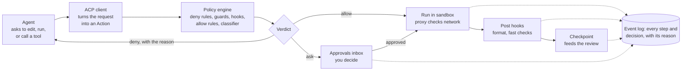

# Component architecture

How each piece of Forge is built, in the order a request flows through it. The overview and tech choices are in [overview.md](overview.md).

## Crate layout and process model

One Cargo workspace for the daemon and CLI, and one pnpm workspace for the UI. Each core module is its own crate behind a trait, so it can be tested without a live agent.

| Crate or package | Role |
| --- | --- |
| `forged` | Daemon binary: wires the crates together, owns the Tokio runtime |
| `forge` | CLI: a thin client of the daemon API (`forge session new`, `forge review`) |
| `forge-api` | JSON-RPC method and event types; generates TypeScript types for the UI |
| `forge-session` | Session lifecycle and supervision |
| `forge-acp` | ACP client, wrapping the official `agent-client-protocol` crate |
| `forge-sandbox` | Isolation backends behind one `Sandbox` trait |
| `forge-policy` | Rules, modes, guards, classifier |
| `forge-hooks` | Hook runner and plugin loader |
| `forge-git` | Worktrees, branches, shadow refs (gitoxide, falling back to the git CLI) |
| `forge-review` | Changesets, comment threads, GitHub sync |
| `forge-lsp` | Language server lifecycle and routing |
| `forge-mcp` | MCP hub and Forge's own MCP server |
| `forge-events` | Event log, search index, OpenTelemetry export |
| `forge-config` | Project, workspace, and agent-profile config, with layering |
| `forge-fake-agent` | Scripted ACP agent that replays a YAML script of steps, for tests |
| `apps/desktop` | Tauri 2 shell; minimal Rust, no business logic. Its `src-tauri` crate (`forge-desktop`) is a Cargo workspace member |
| `packages/ui` | SolidJS app |
| `packages/client` | Typed daemon client generated from `forge-api` |
| `packages/editor` | CodeMirror 6 extensions: diff, comments, agent-file schemas |

**Process tree**

- `forged` runs as a user service (systemd user unit on Linux, launchd agent on macOS). The desktop app starts it if it isn't running.
    - One sandbox per session, holding the agent process and any commands it runs.
    - Language servers, one set per workspace.
    - Local MCP servers (stdio), proxied by the MCP hub.
- The desktop app, CLI, and future mobile client connect to `forged`; none of them own state.

## Life of a tool call



A denied action goes back to the agent with its reason; an ask waits in the inbox; only allowed or approved actions run, and every step lands in the event log.

## Daemon API

JSON-RPC 2.0 over WebSocket, with requests for commands and server-pushed notifications for everything that changes. The same API serves the desktop app, the CLI, and later remote and mobile clients.

- **Transport.** WebSocket framing everywhere, one JSON-RPC message per text frame. Local clients speak it over a Unix socket (`$XDG_RUNTIME_DIR/forge/forged.sock`, falling back to `<data>/forged.sock` when `XDG_RUNTIME_DIR` is unset); remote ones will use WebSocket over TLS. The Tauri shell bridges the UI to the socket so the webview never opens a network port; it forwards frames and starts `forged` if nothing is listening, and holds no other logic.
- **Startup.** `forged` refuses to start if another daemon answers on the socket, replaces a stale socket left by a crash, refuses to touch a non-socket file at that path, and rejects connections from other users (socket mode plus a peer-uid check). It creates missing data and runtime directories with mode 0700 and refuses existing ones that other users can access, without changing their mode. It binds the socket before opening the database, so a second daemon never touches the live one's database. An invalid user config stops startup with the parse error.
- **Auth.** Local: socket file permissions. Remote: per-device tokens issued by `forge pair`, scoped read-only or full.
- **Schema.** `forge-api` defines every method and event in Rust; TypeScript types are generated from it, so UI and daemon can't drift.

| Method group | Examples |
| --- | --- |
| `project.*` | `open`, `list`, `config.get` |
| `workspace.*` | `repos`, `addRepo`, `status` |
| `session.*` | `create`, `prompt`, `cancel`, `rewind`, `setMode` |
| `approval.*` | `list`, `decide` |
| `review.*` | `changeset`, `comment`, `requestChanges`, `acceptHunk`, `ship` |
| `lsp.*` | `diagnostics`, `definition`, `hover` (human editor) |
| `mcp.*` | `servers`, `install`, `authorize` |
| `events.*` | `subscribe`, `query`, `replay` |

**Subscriptions.** A client subscribes to topics (`session/<id>`, `approvals`, `board`). Each notification carries a monotonically increasing sequence number, so a client that reconnects asks for everything after its last number instead of reloading.

## Session manager

Each session is a supervised Tokio task that owns one agent connection, one set of worktrees, and one sandbox. If the agent crashes, the session survives and can resume.

| State | Meaning | Moves to |
| --- | --- | --- |
| Provisioning | Creating worktrees, starting the sandbox, launching the agent | Ready, Failed |
| Ready | Agent connected, waiting for a prompt | Working |
| Working | Agent is running a turn | Waiting, Ready, Paused, Failed |
| Waiting | Blocked on an approval or a question for the human | Working, Paused |
| Paused | Stopped by the human, a budget cap, or the Auto circuit breaker | Working, Done |
| Review | Agent reported done; checks ran; changeset ready | Working (changes requested), Done |
| Done | Shipped or abandoned; worktrees kept until cleanup | — |
| Failed | Unrecoverable error; transcript and worktrees kept | Provisioning (retry) |

- **Persistence.** Session metadata lives in SQLite; transcripts and checkpoints in `.forge/sessions/<id>/`. On daemon restart, sessions that were Working come back as Paused with a note, never resumed silently.
- **Resume.** Uses ACP session loading when the agent supports it. Otherwise Forge starts a fresh agent session primed with the task, the plan, and a summary of the transcript.
- **Concurrency limits** per project (default 5 sessions) and per machine, so parallel agents don't exhaust memory.
- **Budgets.** Token and cost meters update from ACP usage reports; crossing a cap moves the session to Paused.

## ACP client and agent adapters

`forge-acp` makes Forge a full ACP client, so anything an agent asks of the editor (read a file, run a command, get permission) goes through the core.

- **Launch.** The agent profile names a command (`claude-code-acp`, `codex-acp`, `gemini --acp`). It runs inside the session's sandbox and speaks JSON-RPC over stdio.
- **Negotiation.** Forge advertises file-system and terminal capabilities and records what the agent advertises (session loading, plans, modes, slash commands). The UI hides features an agent doesn't support.
- **File access.** File reads and writes requested over ACP resolve against the session's worktrees only. Writes pass the policy engine and the pre- and post-edit hooks.
- **Terminals.** ACP terminal requests become processes in the sandbox; output streams to the UI and the event log.
- **Permission requests** go straight to the policy engine. An "ask" result becomes an approval-inbox item; the agent waits on the response.
- **MCP hand-off.** At session start Forge passes the MCP hub's per-session endpoint, so every MCP tool call is visible and policy-checked.
- **Updates.** Plan updates, tool-call progress, and message chunks become session events for the board and timeline.

**Adapter registry.** A small manifest per agent: install command, version pin, auth check, and known quirks (for example, which native tools bypass ACP's file methods). Native shims cover what ACP can't, such as writing an agent's own settings file so its built-in permission mode defers to Forge.

**Agents that edit outside ACP.** Some agents use their own file and shell tools instead of ACP's. Forge doesn't depend on seeing those calls: the sandbox bounds them, and the review store reads the worktree's git diff.

## Sandbox

The sandbox is the backstop: whatever the agent does, inside or outside ACP, it can't reach past its worktrees and its allowed network. `forge-sandbox` exposes one `Sandbox` trait with three backends, plus an opt-out for users who choose to run without isolation.

| Tier | Linux backend | Use |
| --- | --- | --- |
| Light | Landlock + seccomp, no namespaces | Fast start; Ask and Accept-edits modes |
| Standard | bubblewrap: user, mount, PID, and network namespaces | Default for Auto |
| Container | Rootless Podman, devcontainer image per stack | Full access; untrusted repos |
| Unsandboxed | None: the agent runs as a normal user process | Opt-in only; for users who accept the risk |

macOS uses Seatbelt profiles for Light and Standard and a lightweight VM for Container.

**Unsandboxed tier.** Available, but Forge steers users away from it:

- Off by default. Enabling it takes an explicit setting per agent profile or project, never a global default, and org-managed policy can forbid it.
- Sessions running unsandboxed show a persistent warning badge on the board, in the session header, and in the review pane.
- Choosing it for Auto or Full access asks for confirmation each time a session starts.
- What still applies: the policy engine, hooks, and guards for every action routed through ACP and the MCP hub; the egress proxy, if the user keeps it on; pushes only from the daemon; and review from the worktree's git diff.
- What no longer applies: limits on anything the agent does with its own tools outside ACP. It can read all of `$HOME`, including `~/.ssh`, and reach any host.
- The session start screen offers a one-click switch to Standard and says what would change.

**Isolation details**

- **Filesystem.** Read-write: the session's worktrees and a scratch dir. Read-only: toolchains and caches (`~/.cargo`, `~/.npm`, `~/.rustup`). Hidden: the rest of `$HOME`, including `~/.ssh` and other projects.
- **Network.** All egress goes through a per-session proxy that enforces the allowlist (package registries, the model API, approved hosts) and logs every connection. Light tier, which can't redirect traffic, blocks network except the model API.
- **Secrets.** Never written into the sandbox's environment by default. Profiles name secrets from the OS keyring or a vault; the proxy injects them as request headers, so the agent never sees the raw value.
- **Git credentials** stay outside: pushes go through `forged`, never from inside the sandbox.
- **Resources.** cgroup limits for CPU, memory, and process count per session.

## Policy engine

Every action an agent wants to take becomes an `Action` and gets exactly one `Decision`: allow, deny, or ask, always with a reason and the rule that produced it.

```rust
pub enum Action {
    Edit { path: PathBuf, kind: EditKind },
    Exec { argv: Vec<String>, cwd: PathBuf },
    Network { host: String, port: u16 },
    McpCall { server: String, tool: String, args: Value },
    Git { op: GitOp },
}

pub struct Decision {
    pub verdict: Verdict,   // Allow | Deny | Ask
    pub reason: String,
    pub source: RuleSource, // which layer and rule decided
}
```

**Evaluation order** (first match wins; later steps never loosen earlier ones)

1. **Hard denies** from org, user, then project policy.
2. **Guards:** secret scan, protected paths, new-dependency check, injection flags on content the agent fetched.
3. **Pre-tool hooks** (allow, deny, or ask, or modify the arguments).
4. **Explicit allow and ask rules** for the session's mode.
5. **Classifier**, in Auto mode only, for whatever is still undecided.
6. **Mode default:** Ask mode asks; Accept-edits allows edits in the worktree and asks for the rest.

**Rules** are TOML, layered org → user → project → session:

```toml
[[deny]]
exec = ["git push --force*", "rm -rf /*"]
reason = "Destructive or history-rewriting"

[[allow]]
exec = ["cargo test*", "pnpm test*"]
modes = ["accept-edits", "auto"]
```

**Classifier interface.** A trait taking the action, recent transcript turns, the task, and the project's rules files, and returning a verdict and a reason. Backends: an API model, a local model, or none. Timeout or error means Ask, never Allow. A per-session counter enforces the circuit breaker.

**Decision records** go to the event log, and the timeline shows them inline with the action they decided.

## Hooks and plugins

Forge runs hooks itself, outside the agent, so the same hook works for every agent whether or not that agent has a hook system.

| Event | Can block or modify | Typical use |
| --- | --- | --- |
| `session.start` | No | Install deps, warm caches |
| `tool.pre` | Yes: allow, deny, ask, rewrite args | Block risky commands, add flags |
| `tool.post` | No; can add a note for the agent | Log, lint touched files |
| `edit.pre` | Yes | Protect generated files |
| `edit.post` | No; can add a note | Format, run fast checks |
| `commit.pre` | Yes | Tests, secret scan |
| `task.done` | Yes: can send the session back to Working | Acceptance checks |
| `approval.requested` | No | Notify a phone or chat channel |

- **Runtimes.** Shell commands receive JSON on stdin and return JSON on stdout. WASM modules (WASI) run in-process with a fuel limit and no ambient filesystem access. Both have a timeout; a hook that times out counts as "no decision".
- **Where they run.** Hooks that only read run inside the session's sandbox; hooks that need credentials (notifications) run in the daemon with their own narrow permissions.
- **Compatibility.** Forge can import Claude Code-style hook definitions, since several agents and VS Code now share that format.

**Plugin package.** A directory with a `forge-plugin.toml` manifest listing its contents: skills, slash commands, subagent definitions, hooks, MCP servers, rules fragments, and optional UI panels (a Solid component loaded in an iframe that talks to the daemon API with a scoped token). Plugins install per user or per project; project plugins are pinned by hash in `.forge/plugins.lock`.

## Worktrees and git

Each session gets its own git worktree in every repo it touches, on its own branch, so parallel agents never share a working directory.

- **Location.** `~/.local/share/forge/worktrees/<project>/<session>/<repo>/`, outside the repos themselves so editors and file watchers don't pick them up.
- **Branches.** `forge/<session-slug>` from the base branch the task names. The human renames or squashes at ship time.
- **Multi-repo sessions.** A session declares its repos up front; the agent may request another mid-session, which is an approval. Worktrees are created together and the agent's working directory is a parent folder linking them, so paths like `api/src/...` and `web/src/...` work.
- **Shared caches.** Build output (`target/`, `node_modules/`) is per worktree by default; sccache and pnpm's store keep rebuilds cheap.
- **Overlap detection.** On every edit event, Forge compares the touched paths against other live sessions in the same repo. A hit marks both sessions on the board and suggests a merge order. Conflicts are resolved at ship time by rebasing the later changeset.
- **Pushes** happen only from the daemon, with the user's credentials, after review.
- **Cleanup.** Done and abandoned sessions keep their worktrees for 7 days (configurable), then `git worktree remove`; branches stay until deleted.

## Review store

The review store turns a session's git history into something reviewable like a pull request. It reads git, not agent events, so review is accurate whichever tools the agent used.

- **Checkpoints.** After each agent turn (and before any risky action), Forge snapshots the worktree, including untracked files, into a commit on a shadow ref: `refs/forge/<session>/cp/<n>`. Rewind is `git reset --hard` to a checkpoint plus restoring the ACP session state from that point.
- **Changeset.** The diff from the base branch's merge-base to the latest checkpoint, per repo. Each hunk is mapped back to the checkpoint and transcript turn that produced it, which powers the Why panel.
- **Review rounds.** Each "Request changes" records the checkpoint it reviewed. "Changes since last review" is the diff between that checkpoint and the newest one.
- **Comment threads** are stored in SQLite, anchored to a file, a line range, and the checkpoint they were written on. When code moves, anchors follow the diff; if the lines are gone, the thread is marked outdated, as on GitHub.
- **Request changes** sends the agent one structured message: the threads as a list of file, range, quoted code, and comment. The agent replies per thread ID, and Forge posts each reply into its thread.
- **Per-hunk accept and revert** are commits the human makes on the session branch, so the agent sees them on its next turn.
- **GitHub sync.** Ship pushes the branch and opens the PR. Afterwards a sync job maps PR review comments to Forge threads and back, by file, line, and commit. Multi-repo changesets open one PR per repo, each linking the others.

## LSP host

`forge-lsp` runs language servers for the human editor and for agents, and routes each request to the server that has the right files open.

- **Discovery.** Detect stacks from manifest files, then resolve servers from a registry (rust-analyzer, typescript-language-server, basedpyright, gopls, jdtls, clangd), installing missing ones into `~/.local/share/forge/servers/`.
- **Per-worktree strategy.** Default: one server instance per worktree, started lazily on the first request and stopped after 10 idle minutes. A per-machine memory budget evicts the least recently used server first. Later: one server per repo with virtual-document overlays for session worktrees, for servers that handle it well.
- **For the human.** The UI's CodeMirror `lsp-client` talks to the daemon, which proxies to the server for whatever is open: the main checkout or a session's worktree in the review pane.
- **For agents.** Forge's MCP server exposes `definition`, `references`, `hover`, `rename_preview`, and `diagnostics`. After each edit, new diagnostics are attached to the tool result so the agent sees errors immediately.
- **Review integration.** Diagnostics are computed at each checkpoint and pinned to hunks, so a hunk that introduces an error is flagged in the changeset view.
- **Crash handling.** Restart with backoff; after three crashes in 5 minutes, mark the language degraded and keep going without it.

## MCP hub and Forge MCP server

Agents never connect to MCP servers directly. They connect to one per-session endpoint on the hub, which fans out to the real servers, so every tool call is visible, policy-checked, and logged.

- **Server management.** Servers are declared in `.mcp.json` (read as-is for compatibility) or Forge config. Stdio servers run as daemon children, outside agent sandboxes; remote servers connect over Streamable HTTP. OAuth tokens live in the OS keyring.
- **Per-session endpoint.** Streamable HTTP on a Unix socket or loopback port bound into the sandbox. The hub merges tool lists, namespacing by server (`github.create_issue`), and filters them by the agent profile's allowlist.
- **Tool budget.** The hub reports each tool's schema size in tokens, so the context inspector can show what MCP costs and profiles can trim unused tools.
- **Policy.** Every `tools/call` becomes an `McpCall` action. Results from tools that fetch outside content are scanned for prompt-injection patterns and flagged in the transcript.
- **Health.** Periodic pings; a failing server is marked down on the board and its tools are removed from new sessions.

**Forge's own MCP server** is mounted on the same hub:

| Tool | Purpose |
| --- | --- |
| `lsp_*` | Definition, references, hover, rename preview, diagnostics |
| `task_get`, `task_update_plan` | Read the task spec; publish a plan for approval |
| `review_threads`, `review_reply` | Read open review comments; answer them |
| `checks_run` | Run the task's acceptance checks |
| `browser_open`, `browser_screenshot` | Drive the built-in preview of a dev server |
| `ask_human` | Put a question in the approvals inbox and wait |

## Event log

Everything that happens in a session is an event appended to one log. The timeline, replay, search, cost meters, and telemetry are all views of it.

```rust
pub struct Event {
    pub seq: u64,              // per-session, gap-free
    pub session: SessionId,
    pub at: DateTime<Utc>,
    pub kind: EventKind,       // Prompt, AgentMessage, ToolCall, Decision,
                               // Edit, Checkpoint, Approval, HookRun, Usage...
    pub parent: Option<u64>,   // links a Decision or HookRun to its ToolCall
    pub body: Value,           // redacted before write
}
```

- **Storage.** JSONL per session in `.forge/sessions/<id>/events.jsonl` is the source of truth, easy to read and diff. SQLite holds an index (kind, time, tool, path) plus FTS5 full-text search over messages and tool output.
- **Redaction** runs before write: secret patterns and values the vault injected are replaced with placeholders, so transcripts are safe to share.
- **Replay.** The timeline steps through events; jumping to a checkpoint event shows the worktree at that point from its shadow ref.
- **Streaming.** The daemon API's subscriptions are this log, filtered by topic; sequence numbers make reconnects lossless.
- **OpenTelemetry.** Optional exporter maps a session to a trace, each agent turn to a span, and tool calls and decisions to child spans with cost and latency attributes.
- **Retention.** Configurable per project; deleting a session removes its log, index rows, and shadow refs together.

## Config and project model

Config is plain files, checked into the repo where it belongs to the project and kept in the user's config dir where it belongs to the person.

```
forge.toml                 # project: name, repos, default agent, budgets
.forge/
  workspace.toml           # repos, base branches, shared rules file
  agents/claude.toml       # agent profiles: command, model, mode, MCP allowlist
  policy.toml              # project deny/allow rules
  hooks/                   # hook scripts and WASM modules
  tasks/*.md               # task specs (frontmatter + body)
  plugins.lock             # pinned plugin hashes
  sessions/                # local only, gitignored
~/.config/forge/
  config.toml              # user defaults, keymaps, theme
  policy.toml              # user rules
/etc/forge/managed.toml    # org-managed policy (read-only to users)
```

- **Layering.** Managed → user → project → session for policy, where lower layers can only tighten. For preferences (model, theme, keymaps) the most specific layer wins.
- **Validation.** Every file has a JSON Schema generated from its Rust type. The editor uses the same schema for completion and inline errors.
- **Agent-file sync.** Rules can be authored once in `AGENTS.md` plus optional per-agent fragments in `.forge/rules/`. `forge rules sync` writes `CLAUDE.md`, `GEMINI.md`, `.github/copilot-instructions.md`, and Cursor rules from them, each marked as generated, or creates symlinks where the agent accepts them. Drift between source and generated files shows as a lint warning.
- **Effective-context preview.** For a given path and agent, the daemon resolves the full hierarchy of rules files that agent would load and returns the merged text with per-file token counts.

## Desktop UI

The UI is a SolidJS app that renders daemon state; it holds no state the daemon doesn't also have, except view preferences.

**Structure**

```
packages/ui/src/
  host/          # the only code that touches Tauri: window, menus, file dialogs, notifications
  client/        # daemon connection, subscriptions, reconnect with sequence numbers
  stores/        # Solid stores per topic: projects, sessions, board, approvals, review
  features/
    board/       # agent board, session cards
    inbox/       # approvals queue
    review/      # changeset view, threads, Why panel
    editor/      # tabs, file tree, CodeMirror host
    session/     # transcript, timeline, context inspector
    agentfiles/  # markdown and agent-file editors
  ui/            # shared primitives: split panes, virtual lists, command palette
```

- **State.** Each store is a Solid `createStore` fed by daemon notifications through a reducer per event kind. Streaming agent output updates one message's text signal, so only that node re-renders.
- **Review pane.** The file list is virtualized; each file's diff is a CodeMirror instance created when scrolled into view and destroyed when far away. Comment threads and diagnostics are CodeMirror widgets and gutter markers. This is the performance hot spot to test on WebKitGTK first.
- **Editor.** One CodeMirror instance per open tab, with `@codemirror/lsp-client` pointed at the daemon. Agent files get schema-driven completion and lint extensions from `packages/editor`.
- **Commands.** Every action is a named command with a keybinding and a palette entry, so the CLI, palette, and keymaps share one list.
- **Layout.** Dockable split panes; the default layout puts the board and inbox left, review center, transcript right. Layouts are saved per project.
- **Host boundary.** Components import from `host/`, never from `@tauri-apps/*`. A browser build swaps `host/` for a web implementation, which is also how the remote and mobile clients start.
