# Forge: Agent Development Environment Spec

Oct 22, 2026 · Jeff

## Overview

Forge is a desktop environment where developers direct and review coding agents, and edit code by hand only when they need to. The agent is the primary author. The human is architect, reviewer, and approver.

**Design principles**

- **Review-first.** The review pane is the home screen; the editor is secondary.
- **Agent-agnostic.** Any agent that speaks ACP plugs in, with no lock-in to one vendor.
- **Secure by default.** Every agent runs sandboxed, and policy is enforced outside the agent process.
- **Files are the source of truth.** Agent config lives in the repo's markdown, TOML, and JSON files, not a private database.
- **Local-first.** Works offline with local models; remote runners are optional.

**Target user:** an engineer running one to five agents in parallel across one or more repos, who wants to review agent output the way they review a teammate's PR.

## Core concepts

A project holds workspaces; a workspace holds repos; agents work in sessions, and every session produces one changeset that is reviewed as a unit.

| Concept | What it is | Stored in |
| --- | --- | --- |
| Project | One product or effort. Holds workspaces, agent profiles, policies, the task backlog, and secret references. | `forge.toml` + `.forge/` at the project root or in a meta-repo |
| Workspace | A set of repos opened together, each pinned to a branch. Multi-repo by default. | `.forge/workspace.toml` |
| Agent profile | A configured agent: ACP command, model, permission mode, MCP servers, rules files. | `.forge/agents/*.toml` |
| Session | One agent on one task, in its own worktree for each repo it touches. | `.forge/sessions/` (transcript, checkpoints) |
| Task | A unit of work: spec, plan, acceptance checks, linked sessions. | `.forge/tasks/*.md`, or synced from GitHub Issues |
| Changeset | Everything a session changed, across repos. Reviewed as one unit, shipped as one or more linked PRs. | Git branches + review metadata |

**Multi-repo workspaces.** A session can span repos, for example `api` + `web` + `infra`. Its worktrees are created together, its changeset shows one tab per repo, and it ships as linked PRs that reference each other. A workspace-level rules file merges with each repo's own `AGENTS.md`, so cross-repo conventions live in one place.

**Projects** are the unit for policy, budgets, and history. Switching projects swaps the agent board, the open workspaces, and the active guards together.

## Features

### Agent connectivity (ACP)

ACP is the primary integration. It is an open JSON-RPC standard for how coding agents talk to editors, and more than 25 agents supported it as of March 2026 ([source](https://www.morphllm.com/agent-client-protocol)).

- **Adapters for the big two.** Claude Code and Codex predate ACP and connect through adapters such as `claude-code-acp` and `codex-acp` ([source](https://ai-sdk.dev/providers/community-providers/acp)).
- **Full client capabilities.** File read/write, terminal, plan rendering, agent-advertised slash commands, session load and resume, and permission requests.
- **MCP hand-off.** ACP clients pass MCP endpoints to the agent at session start, so Forge-managed MCP servers, including Forge's own, reach every agent.
- **Agent registry.** Install, update, and pin agent versions; show auth status per agent.
- **Thin native shims** only where ACP has no equivalent, such as each agent's own hook or settings format.

### Orchestration

- Parallel sessions, each in its own worktree per repo, optionally inside a container.
- **Agent board:** every session's state (planning, working, waiting on you, ready for review, done), current step, cost, and elapsed time.
- **Approvals inbox:** every pending permission request and question across all sessions, in one queue.
- **Overlap detection:** warns when two sessions edit the same paths and suggests a merge order.
- **Hand-offs:** one session's output feeds another, for example implementer then reviewer agent.
- Background and remote runners, with desktop and phone notifications.

### Code review panes

Review works like a GitHub pull request, but the author is an agent that answers immediately.

- **Changeset view:** file tree with +/− counts, split or unified diff, a viewed checkbox per file, generated files collapsed.
- **Inline comments** on a line or range. **Request changes** sends every open comment to the agent as one structured batch (file, line range, comment).
- **Threads resolve** when the agent's fix lands; the agent replies in each thread with what it changed.
- **Changes since last review:** after a revision, show only the new diff, as GitHub does.
- **Suggested-change blocks** you can apply locally, plus per-hunk accept and revert.
- **Why panel:** for any hunk, the task spec, the agent's plan, and the transcript excerpt that produced it.
- **Diagnostics in the diff:** a hunk that introduces an LSP error or failing test is flagged before you read it.
- **GitHub round-trip:** push the branch, open the PR, and sync PR comments both ways. Linked PRs for multi-repo changesets.
- **Reviewer agent (optional):** a first pass whose comments appear marked as AI, for you to keep or dismiss.

### Auto mode and permissions

Forge separates two controls, as Codex does: an approval policy (when to ask) and a sandbox level (what the OS allows) ([source](https://codex.danielvaughan.com/2026/03/26/codex-cli-approval-modes-sandbox-security)).

| Mode | File edits | Commands | Network |
| --- | --- | --- | --- |
| Ask | Prompt | Prompt | Prompt |
| Accept edits | Auto, inside worktree | Prompt | Prompt |
| Auto | Auto | Classifier decides | Allowlist, then classifier |
| Full access | Auto | Auto | Auto |

In v0.1, network access is the agent profile's egress allowlist in every mode, with no prompts; rules-only Auto asks for commands no rule allows, failing closed until the classifier arrives; and Full access runs on whatever sandbox tier the session uses, with deny rules, guards, and hooks still applying. The full table per action type is in component-architecture.md (Policy engine).

**How Auto works**

1. **Hard deny rules** run first and cannot be overridden. Claude Code's `permissions.deny` works the same way, ahead of its classifier ([source](https://code.claude.com/docs/s/claude-code-auto-mode)).
2. **Sandbox** limits what any command can touch, whatever the classifier says.
3. **Classifier** reviews each remaining tool call and blocks destructive, irreversible, or exfiltrating actions; the agent is told why and tries another approach ([source](https://claude.com/ko-kr/blog/auto-mode)). It reads the project's rules files, so "never force push" in `AGENTS.md` steers it. The model is pluggable: local, API, or rules-only.
4. **Circuit breaker:** repeated blocks drop the session back to Ask. Claude Code uses 3 in a row or 20 total ([source](https://www.dsebastien.net/claude-code-auto-mode/)).
5. **Fail closed:** if the classifier is unavailable, pause and prompt. A reported Claude Code bug shows why this needs to be explicit ([source](https://github.com/anthropics/claude-code/issues/82653)).

Entering Auto drops broad allow rules such as `Bash(*)` and interpreter wildcards, as Claude Code does. For ACP agents, Forge answers the agent's permission requests itself, so one policy applies to every agent. Every decision is logged with its reason and shows in the session timeline.

### Editor and language support (LSP)

- Editor core with tree-sitter highlighting, multi-cursor, and Vim and Emacs keymaps.
- **LSP client** that detects the stack from manifest files (`Cargo.toml`, `package.json`, `pyproject.toml`, `go.mod`, `pom.xml`) and installs the matching server: rust-analyzer, typescript-language-server, basedpyright, gopls, jdtls, clangd.
- **LSP for agents:** Forge's MCP server exposes go-to-definition, find references, rename, hover types, and diagnostics. Agents navigate by symbol instead of grepping, and see new errors right after each edit.
- Diagnostics appear inline in review diffs, not only in the editor.
- Devcontainer templates per stack, so a session's sandbox has the right toolchain.
- Debugging over DAP later.

### Markdown and agent files

- Markdown with live split preview, Mermaid, tables, and a frontmatter form editor.
- Forge recognizes these files out of the box, with schema-aware editing and linting:

| File | Used by |
| --- | --- |
| `AGENTS.md` | Cross-agent standard (Codex and many others) |
| `CLAUDE.md`, `.claude/settings.json`, `.claude/commands/`, `.claude/agents/` | Claude Code |
| `SKILL.md` | Agent skills |
| `GEMINI.md` | Gemini CLI |
| `.cursor/rules/*.mdc` | Cursor |
| `.github/copilot-instructions.md` | GitHub Copilot |
| `.mcp.json` | MCP server config |
| `~/.codex/config.toml` | Codex |

- **Lint:** invalid frontmatter, broken file references, rules that contradict each other, and token cost per file.
- **Effective-context preview:** how hierarchical files merge for a given path (user, then repo root, then subdirectory).
- **Single source:** author rules once and generate or symlink each agent's file, so teams on several agents stay consistent.
- Templates for new repos.

### Plugins, hooks, and guards

- **Plugins** bundle skills, commands, subagent definitions, hooks, MCP servers, and UI panels. Import Claude Code plugins where the format allows.
- **Hooks** on session start, pre and post tool call, pre and post edit, pre-commit, task done, and notification. Written as shell scripts or WASM modules. Forge runs them itself, so they work for every agent, even ones with no hook system of their own.
- **Guards:** secret scanning on edits and output, protected paths (`.env`, CI config, lockfiles), network egress allowlist, new-dependency check (license, typosquatting), and prompt-injection flags on fetched content.
- **Policy layers:** org-managed, then user, then project, then session. A lower layer can tighten a rule but never loosen it.

### Context and cost

- **Context inspector** per session: rules files, memory, skills, MCP tool schemas, and files read, each with its token count.
- Token and cost meters per session, task, and project, with budget caps that pause a session.
- Memory browser and editor.

### Verification loop

- Tasks carry acceptance checks (commands). A session can't report done until they pass.
- Agents can start dev servers and screenshot a built-in browser preview.
- CI status shows in review; a failing CI log can be sent to the agent in one click.
- Eval harness for testing changes to skills, hooks, and rules files before rollout.

### MCP management

- Browse a registry, install, handle OAuth, and check health.
- Choose which tools each agent profile sees, with each tool's token cost.
- Forge's own MCP server exposes LSP, tasks, review comments, and the browser preview.

### Observability

- **Session timeline:** every prompt, tool call, permission decision, and edit, with replay.
- Checkpoints and rewind to any point.
- Search across all transcripts; OpenTelemetry export.

## Architecture

A Rust daemon, `forged`, owns everything stateful. The desktop UI, a CLI, and later a mobile client are thin clients of it.

```mermaid
flowchart LR
  subgraph UI["Desktop UI"]
    ed["Editor + LSP"]
    rv["Review panes"]
    bd["Agent board"]
    ib["Approvals inbox"]
  end
  subgraph Core["Forge core daemon (forged)"]
    ses["Sessions"]
    pol["Policy engine"]
    rs["Review store"]
    git["Worktrees + git"]
    lsp["LSP host"]
    mcp["MCP hub"]
    hk["Hook runner"]
    log["Event log"]
  end
  subgraph SB["Sandboxed agents"]
    cc["Claude Code"]
    cx["Codex"]
    gm["Gemini CLI"]
    any["Any ACP agent"]
  end
  ext["External services: language servers, MCP servers, GitHub, model providers"]
  UI <-->|local API| Core
  Core <-->|ACP| SB
  Core <-->|"LSP · MCP · REST"| ext
  SB -->|"model APIs (allowlisted)"| ext
```

Agents reach the UI only through the core and its policy engine; anything they do outside ACP stays inside the sandbox and shows up in the worktree diff.

- **Process model.** Because the daemon owns sessions, closing the UI doesn't stop the agents, and remote runners use the same API.
- **Agents** run one process per session inside a sandbox and talk ACP over stdio. On Linux, use bubblewrap or Landlock plus seccomp, or a rootless Podman container per session. Codex's Linux sandbox uses the same Landlock and seccomp primitives ([source](https://codex.danielvaughan.com/2026/03/26/codex-cli-approval-modes-sandbox-security)).
- **Policy engine** is the single decision point for ACP permission requests, hooks, guards, and the Auto classifier. It returns allow, deny, or ask, with a reason, to the event log.
- **Review comes from git, not from agent events.** Agents can edit through their own tools rather than ACP's file methods, so the changeset is the diff of the session's worktree. Shadow refs per checkpoint make rewind and "changes since last review" cheap.
- **Event log** is append-only (SQLite plus JSONL transcripts). It feeds the timeline, replay, search, and OpenTelemetry export.
- **LSP host** runs language servers shared by the human editor and, through Forge's MCP server, by agents.
- **Config** lives in the repo's `.forge/`, layered with the user's `~/.config/forge/` and org-managed policy.

Per-component design: [component-architecture.md](component-architecture.md)

## Tech stack

Forge's UI is a Tauri 2 webview app written in SolidJS and TypeScript, with CodeMirror 6 as the editor core. The UI is a client of the Rust daemon, so the shell can change later without touching the core.

| Layer | Choice | Why |
| --- | --- | --- |
| Desktop shell | Tauri 2, system webview | Rust backend fits the daemon; small binaries |
| UI framework | SolidJS + TypeScript | Fine-grained reactivity with no virtual DOM, so streaming agent output and large diffs don't trigger re-render storms |
| Editor | CodeMirror 6 | Modular and light; Forge needs many embedded editors (diff hunks, comment boxes, agent files) |
| Diff and review | `@codemirror/merge` | Split and unified diffs on the same editor core |
| Editor language features | `@codemirror/lsp-client`, talking to the daemon's LSP host | The human and the agents share one set of language servers |
| Terminal | xterm.js | Standard; streams session output |
| Markdown | CodeMirror markdown mode for editing; remark + Mermaid for preview | One parser path for preview and agent-file linting |
| Long lists | `@tanstack/solid-virtual` | Agent board, file trees, timelines |
| Core daemon | Rust, Tokio, SQLite | Owns sessions, policy, git, event log |
| UI to daemon | JSON-RPC over WebSocket | The same API later serves browser and mobile clients |
| Agents | ACP over stdio via the official `agent-client-protocol` Rust crate | |
| Sandbox | bubblewrap or Landlock + seccomp; rootless Podman per session | |

**Keep the shell swappable.** Components never call Tauri APIs directly; everything goes through a thin `host` module. Then moving to Tauri's Chromium (CEF) runtime once it's stable, or to Electron, is a shell change, not a rewrite.

**Known costs**

- **WebKitGTK on Linux** is slower and quirkier than Chromium. Test the review pane with large diffs on Linux early; that is the likely failure point.
- **Solid's ecosystem** is smaller than React's, so there are fewer ready-made diff viewers, trees, and panels. The review UI is Forge's core, so plan to build those components in-house anyway.

## MVP cut

v0.1 proves the review loop with one agent at a time; v0.2 adds parallel agents and multi-repo work. Everything else waits.

### v0.1: one agent, reviewed well

- Linux and macOS; single-repo projects; one active session, still in its own worktree.
- ACP client with Claude Code, Codex, and Gemini CLI.
- Review pane: changeset, split and unified diff, inline comments batched back to the agent, per-hunk revert, changes since last review.
- Modes: Ask, Accept edits, a rules-only Auto (hard denies, rules, and the sandbox; no classifier yet, so it asks where no rule decides), and Full access.
- Editor with tree-sitter and LSP for Rust, TypeScript, Python, and Go.
- Markdown preview and editing; lint for `AGENTS.md` and `CLAUDE.md`.
- Hooks on pre and post tool call (shell only); secret-scan and protected-path guards.
- Agent commits through a minimal Forge MCP endpoint offering `git_commit` (the full MCP hub is v0.2).
- Session timeline with checkpoints and rewind.

**Gate:** two weeks of real work in Forge without falling back to the agent's own terminal UI.

### v0.2: many agents, many repos

- Parallel sessions, agent board, approvals inbox, overlap detection.
- Multi-repo workspaces, cross-repo changesets, linked PRs.
- GitHub round-trip: push, open PR, two-way comment sync.
- Auto mode with classifier, circuit breaker, and fail-closed behavior.
- Context inspector, cost meters, and budget caps.
- MCP hub, plus Forge's MCP server exposing LSP to agents.
- Plugin format v1.

**Gate:** three agents in parallel across two repos, reviewed and merged in one sitting.

### Later

- Remote runners and a mobile client for the board and inbox.
- Reviewer-agent first pass.
- Agent-file sync across formats; eval harness.
- Org-managed policy, OpenTelemetry export.
- DAP debugging, GitLab, more language stacks.

### Non-goals

- Building Forge's own coding agent or model.
- Competing as a general-purpose editor for work with no agent involved.
- Hosted cloud service in the first year.

## Open questions and risks

- [ ] **UI stack.** Decided: Forge owns its UI, built on Tauri 2 with SolidJS and CodeMirror 6 (see Tech stack). Remaining risk is WebKitGTK performance on Linux; the fallback is Tauri's CEF runtime or Electron.
- [ ] **ACP adoption.** VS Code runs Claude, Codex, and Copilot side by side, but through its own per-vendor harnesses (Claude Agent SDK, the Codex extension) tied to a Copilot subscription, not ACP ([source](https://code.visualstudio.com/docs/copilot/agents/third-party-agents)). ACP reaches VS Code only through community extensions. If ACP stalls, Forge needs native adapters for the top agents.
- [ ] **Adapter lag.** Claude Code and Codex reach ACP through adapters, so their newest native features (subagents, their own auto modes, hooks) may arrive late.
- [ ] **Two policy systems.** An agent with its own permission system plus Forge's policy can double-prompt or leave gaps. Proposal: run the agent in its most permissive mode inside the sandbox and let Forge own policy.
- [ ] **LSP per worktree.** Five parallel sessions could mean five rust-analyzer instances. Need a memory budget, or one server with per-worktree overlays.
- [ ] **Classifier cost and latency** on every tool call; decide which model and where it runs.
- [ ] **Licensing.** Open source, open core, or closed.

## Sources

- [What Is the Agent Client Protocol?](https://www.morphllm.com/agent-client-protocol), Morph
- [ACP provider](https://ai-sdk.dev/providers/community-providers/acp), AI SDK docs
- [Claude Code auto mode](https://code.claude.com/docs/s/claude-code-auto-mode), Claude Code docs
- [Auto mode for Claude Code](https://claude.com/ko-kr/blog/auto-mode), Anthropic blog
- [Claude Code Auto Mode](https://www.dsebastien.net/claude-code-auto-mode/), dsebastien.net
- [Auto-mode classifier fallback issue #82653](https://github.com/anthropics/claude-code/issues/82653), GitHub
- [Codex CLI approval modes and sandbox security model](https://codex.danielvaughan.com/2026/03/26/codex-cli-approval-modes-sandbox-security)
- [Third-party agents in Visual Studio Code](https://code.visualstudio.com/docs/copilot/agents/third-party-agents), VS Code docs
